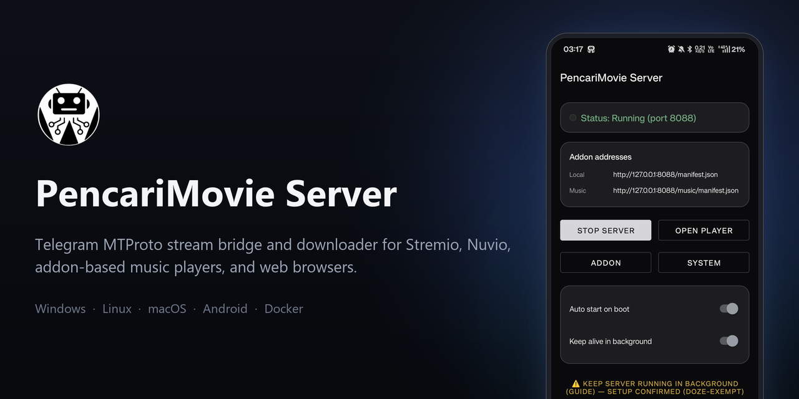

# PencariMovie Server

<p align="center">
  <strong>Self-hosted Telegram MTProto stream bridge and local file downloader for Stremio, Nuvio, addon-based music players such as Eclipse and BitChord, and web browsers.</strong><br>
  Local Execution • Direct MTProto Transport • Zero Cloud Relay
</p>

<p align="center">
  <a href="#what-is-pencarimovie-server">Overview</a> •
  <a href="#quick-install">Quick Install</a> •
  <a href="#1-click-cloud-deployment">Cloud Deploy</a> •
  <a href="#docker--environment-variables">Docker & .env</a> •
  <a href="#stremio-nuvio--music-setup">App Setup</a> •
  <a href="#server-security--remote-token-auth">Security & Auth</a> •
  <a href="#cli-commands-pms">CLI Usage</a> •
  <a href="#features">Features</a> •
  <a href="#legal-disclaimer--dmca-policy">Legal & DMCA</a>
</p>

<p align="center">
  
</p>

---

## What is PencariMovie Server?

PencariMovie Server is a lightweight, self-hosted streaming utility and protocol bridge connecting client applications to Telegram's MTProto API. It converts user-authorized Telegram file references into local HTTP streams with range-request (`HTTP 206`) seek support for media players including Stremio, Nuvio, and web browsers.

- **Client-Side MTProto Bridge**: Directly streams authorized media to the user's local player over MTProto ([`grammers`](https://codeberg.org/Lonami/grammers), compiled into the binary).
- **No Remote File Hosting**: The server does not host, store, or re-transmit media files; streams originate from Telegram's network directly to the local client.
- **Local & Private**: Runs on the user's own hardware (localhost or private LAN) without passing credentials or media bytes to external proxy servers.
- **Cross-Platform**: Available as a native Windows tray application, Linux daemon, Android APK, Termux script, and Docker container.

---

## Quick Install

Install and start the server on your platform:

#### Android (APK for TV / Phone / Tablet)

> [**Download Android APK (telegra.my/apk)**](https://telegra.my/apk) (universal build)
> _(Install on your Android TV, phone, or tablet, tap **Start Server**, and stream)_
> _(If Play Protect blocks the install, tap **More details** (or **Info**) and choose **Install anyway**.)_
> _(The link serves the universal build so it runs on any device. Smaller per-ABI APKs (`arm64-v8a`, `armeabi-v7a`) are on the [APK releases page](https://github.com/aiskendi/pencarimovie-server/releases/tag/apk-server-latest). The app updates itself from that release feed.)_

#### Windows (10 / 11)

Run in **PowerShell**:

```powershell
irm telegra.my/win | iex
```

_(Runs in the background with a system tray icon. Manage anytime with `pms start` or `pms stop`)._

#### Linux

Run in terminal:

```bash
curl -fsSL telegra.my/linux | bash
```

#### macOS (Apple Silicon & Intel)

Run in terminal:

```bash
curl -fsSL telegra.my/mac | bash
```

#### Docker (Any OS / NAS / VPS)

```bash
docker run -d \
  --name pencarimovie-server \
  --restart unless-stopped \
  -p 8088:8088 \
  -v pencarimovie-data:/data \
  ghcr.io/aiskendi/pencarimovie-server:latest
```

The image runs as uid 10001 with `PM_APP_ROOT=/data`, so the volume must be
mounted on **`/data`** (a `/app/storage` mount is silently ignored and every
restart starts from an empty install). With a bind mount, make the host directory
writable by that uid: `sudo chown -R 10001:10001 ./storage`.

Once started, open the web dashboard:
**`http://127.0.0.1:8088`** _(or the local LAN IP printed in your terminal)_

---

## 1-Click Cloud Deployment

Deploy your personal PencariMovie Server to the cloud with a single click:

| Platform    | One-Click Deploy                                                                                                                                                                                                           | Description                                                                |
| :---------- | :------------------------------------------------------------------------------------------------------------------------------------------------------------------------------------------------------------------------- | :------------------------------------------------------------------------- |
| **Orkestr** | [](https://orkestr.eu/new?repo=https%3A%2F%2Fgithub.com%2Faiskendi%2Fpencarimovie-server.git) | Container setup on European cloud infrastructure.                          |
| **Railway** | [](https://railway.com/deploy/ZHHNFC)                                                                                                                                  | Pre-configured template with automatic networking and Docker build.        |
| **Render**  | [](https://render.com/deploy?repo=https://github.com/aiskendi/pencarimovie-server)                                                               | Deploys using native Docker configuration in `render.yaml`.                |
| **Heroku**  | [](https://heroku.com/deploy?template=https://github.com/aiskendi/pencarimovie-server&env[SERVER_TOKEN]=66ff097863dedb7ccd8401d5ffe616f2)                  | Deploys via `app.json` container stack with a pre-configured access token. |

> **Permanent Addon URL on Cloud / PaaS**:
> Always set a static **`SERVER_TOKEN`** (such as `66ff097863dedb7ccd8401d5ffe616f2`) in your cloud provider's environment variables. This keeps your Stremio or Nuvio manifest URL (`https://<your-app>.up.railway.app/<token>/manifest.json`) permanent so you do not need to re-install addons when your container restarts or redeploys.

---

## Docker & Environment Variables

PencariMovie Server can be configured using a `.env` file or container environment variables to set static passwords, tokens, and ports.

### Docker Compose (`docker-compose.yml`)

```yaml
services:
  pencarimovie:
    image: ghcr.io/aiskendi/pencarimovie-server:latest
    container_name: pencarimovie-server
    restart: unless-stopped
    ports:
      - "${PORT:-8088}:8088"
    env_file:
      - .env
    volumes:
      - ./storage:/data
```

### Environment Variables (`.env`)

Create a `.env` file in your project directory:

```ini
# Server Port (auto-assigned by PaaS or default 8088)
PORT=8088

# Remote Access & Security (Permanent token and dashboard password)
SERVER_PASSWORD=your_secure_password
SERVER_TOKEN=66ff097863dedb7ccd8401d5ffe616f2

# Optional: Cloudflare Zero Trust Named Tunnel Token (auto-connects on startup)
TUNNEL_TOKEN=eyJh...

# Optional: Custom Telegram Bot API Token (overrides guest auto-provisioning)
BOT_TOKEN=123456789:ABCdefGHIjklMNOpqrsTUVwxyz

# Optional: Bot pool from environment (comma, space, or newline separated).
# Use this on any host running multiple instances. Because the on-disk pool is local
# to each instance, bots added in the dashboard are only visible to the instance
# that handled the request. Setting BOT_TOKENS ensures all instances load the full pool.
# BOT_TOKENS=111111111:AAA...,222222222:BBB...,333333333:CCC...

# Optional: Local Network IP Override (if running behind multi-adapter Docker bridge)
# LAN_IP=192.168.1.100

# Optional: Cap simultaneous streams (0 = unlimited)
# PM_MAX_STREAMS=0

# Optional: Where sessions, auth, and caches are stored (the Docker image expects /data)
# PM_APP_ROOT=/data
```

### Configuration Variables Reference

| Variable          | Default              | Description                                                                                                                                                                                                     |
| :---------------- | :------------------- | :-------------------------------------------------------------------------------------------------------------------------------------------------------------------------------------------------------------- |
| `PORT`            | `8088`               | Port where the server listens (or provided by PaaS runtime).                                                                                                                                                    |
| `SERVER_PASSWORD` | `123456`             | Password for dashboard access on public IPs, tunnels, and cloud hosts. LAN access is password-free.                                                                                                             |
| `SERVER_TOKEN`    | _(auto-generated)_   | Static access token for public addon URLs (`/<token>/manifest.json`); keeps the link permanent.                                                                                                                 |
| `BOT_TOKEN`       | _(auto-provision)_   | Telegram Bot API token. If omitted, the server mints and rotates guest bots.                                                                                                                                    |
| `BOT_TOKENS`      | _(auto-provision)_   | Pool of bot tokens, comma/space/newline separated (alias `TG_BOT_TOKENS`). Required for multi-instance deployments. Each instance logs in all tokens, and downloads distribute across them.                     |
| `PM_APP_ROOT`     | `storage/`           | Directory where sessions, auth, and caches live.                                                                                                                                                                |
| `PM_MAX_STREAMS`  | `0`                  | Maximum simultaneous streams. `0` = unlimited (the default). Set a limit only on hosts with short request timeouts so clients receive an immediate `503` with `Retry-After` instead of timing out at the proxy. |
| `PM_CACHE_DB`     | `storage/cache.redb` | Cache database path; `off` keeps the cache in memory only.                                                                                                                                                      |
| `PM_LISTEN_HOST`  | `0.0.0.0`            | Bind address: all interfaces by default (`127.0.0.1` for loopback only).                                                                                                                                        |

---

## Stremio, Nuvio & Music Setup

### 1. Stremio Setup

1. Open the dashboard at `http://127.0.0.1:8088` and select **Addon** in the top navigation.
2. **Local Sync (Recommended)**: Click **Install via Stremio API Sync** to push the addon across all your Stremio devices automatically.
3. **Manual / Web**: Copy your manifest URL (`http://<LAN-IP>:8088/manifest.json`, or `http://<SERVER-IP>:8088/<token>/manifest.json` on public servers) and paste it into Stremio's Addon search box.

### 2. Nuvio Setup

1. Open **Nuvio** on your TV, phone, or tablet connected to the same Wi-Fi network.
2. Navigate to **Profile** > **Content & Discovery** > **Addons**.
3. Enter your manifest URL:
   - **Local Wi-Fi / LAN**: `http://<YOUR-LAN-IP>:8088/manifest.json`
   - **Remote / VPS / Tunnel**: `http://<YOUR-SERVER-IP>:8088/<token>/manifest.json` (or your HTTPS tunnel URL).

### 3. Music Addon (Eclipse, BitChord, Stremio, Nuvio)

There is one music manifest, and it is not tied to a single player. Eclipse and BitChord are addon-based music players: they search it and play from it. Stremio and Nuvio have no music content type, so they see the same catalogue as `movie` and `series` rows.

```text
http://<YOUR-LAN-IP>:8088/music/manifest.json
```

On a public or tunnelled server the token goes in front: `http://<YOUR-SERVER-IP>:8088/<token>/music/manifest.json`.

Eclipse Music adds it under **Settings** > **Connections** > **Add Connection** > **Addon**. BitChord adds it under **Settings** > **Sources** > **Add addon**, and its Android app only accepts HTTPS, so it needs the tunnel URL rather than the LAN one. Stremio and Nuvio take it in their addon field.

---

## Server Security & Remote Token Auth

PencariMovie Server includes built-in security controls for remote hosting:

- **Local access is password-free**: Requests from localhost (`127.0.0.1`) and private home subnets (RFC-1918 ranges such as `192.168.x.x` or `10.x.x.x`) bypass authentication.
- **Public and VPS protection**: Requests arriving from public IP addresses or Cloudflare Tunnels require password authentication (`SERVER_PASSWORD`, default `123456`).
- **Remote token routing**: Remote media players authenticate through path tokens in the manifest URL:
  ```text
  http://<vps-ip>:8088/<token>/manifest.json
  ```
  The music addon takes the token in the same position: `http://<vps-ip>:8088/<token>/music/manifest.json`.
- **CLI password and token management**:
  ```bash
  pms password <new_password>   # Changes server password
  pms reset-password           # Resets password to default (123456)
  pms token                    # Prints current access token
  pms token rotate             # Generates a new access token (invalidates old one)
  ```

---

## CLI Commands (`pms`)

The installer registers a global `pms` command:

```bash
pms start              # Starts server in background (checks for updates)
pms stop               # Stops server and background helper processes
pms restart            # Restarts the server
pms tunnel             # Enables Cloudflare Quick Tunnel (or Named Tunnel if token set)
pms autostart [on|off] # Configures auto-start on system boot
pms password <new>     # Sets the server password
pms reset-password     # Resets password to default (123456)
pms token              # Displays the active 32-character access token
pms token rotate       # Rotates the access token
pms uninstall          # Removes server, configuration, and CLI commands
```

Works across Windows, macOS, Linux, and Termux.

---

## Features

- Local setup with automated session handling.
- HTTP 206 range-request streaming for video and audio seeking.
- Stremio Addon v3 protocol compatibility for media playback.
- One music manifest shared by Eclipse Music, BitChord, Stremio, and Nuvio.
- Custom upstream addon bridging to integrate third-party metadata catalogs.
- Built-in web dashboard for local file access and browser playback.
- Local network access for connected TVs and mobile devices (`http://<LAN-IP>:8088`).
- Optional remote access using Cloudflare Tunnel integration (`pms tunnel`).
- Bot pool rotation to distribute concurrent transfers across multiple Bot API credentials.
- System service integration with a native system tray on Windows, `yad` on Linux, and Android background service support.

---

## Legal Disclaimer & DMCA Policy

### Disclaimer

PencariMovie Server is an open-source, non-commercial software tool designed for personal media management, protocol translation, and client-side streaming of user-accessible Telegram files.

1. **No Content Hosting**: This software and its developers do not host, store, cache, upload, or transmit media files or copyrighted material. All media transfers occur directly between the client user, the local software instance, and Telegram's infrastructure.
2. **Third-Party Indexing & Catalogs**: Any metadata, filenames, or search results displayed through client addons or third-party catalog feeds are provided by external sources. The project maintainers do not own, control, or operate third-party Telegram channels or upload services.
3. **User Responsibility**: Users of this software are responsible for ensuring that their use complies with local copyright laws, intellectual property regulations, and Telegram's Terms of Service. The developers disclaim liability for copyright infringement, unauthorized access, or misuse of this software by third parties.

### Notice & Takedown (DMCA / Copyright Inquiries)

If you are a copyright owner, content producer, or legal representative wishing to report unauthorized references or request exclusion of specific titles from discovery endpoints:

- Submit a formal written notice detailing:
  1. The copyrighted work claimed to have been infringed;
  2. The specific identification or URL/query where the reference occurs;
  3. Your contact information (name, organization, email, and phone number);
  4. A statement affirming that you hold the copyright or are authorized to act on behalf of the copyright owner.
- Send all DMCA and copyright inquiries to: **`dmca@pencarimovie.com`** (or submit an issue to the repository maintainer).
- Notices are reviewed promptly, and qualifying metadata references or index entries will be delisted and excluded.

---

## Open Source & Privacy

- **License**: Released under GPL-3.0.
- **Local Isolation**: Media requests, streams, and sessions are processed locally without third-party tracking or cloud relays.
- **Administrative Boundaries**: Management actions (settings, bot pool, tunnel triggers) are restricted to local requests only and blocked across public tunnels.

---

## Credits & Acknowledgments

Built using these open-source projects:

- [**Rust**](https://www.rust-lang.org/): The programming language and compiler producing the single binary.
- [**grammers**](https://codeberg.org/Lonami/grammers): Telegram MTProto client library in Rust.
- [**axum**](https://github.com/tokio-rs/axum): HTTP server framework.
- [**cloudflared**](https://github.com/cloudflare/cloudflared): Cloudflare Tunnel connector for remote access.

---

<p align="center">
  <sub>Open-source project hosted at <a href="https://github.com/aiskendi/pencarimovie-server">github.com/aiskendi/pencarimovie-server</a></sub>
</p>
